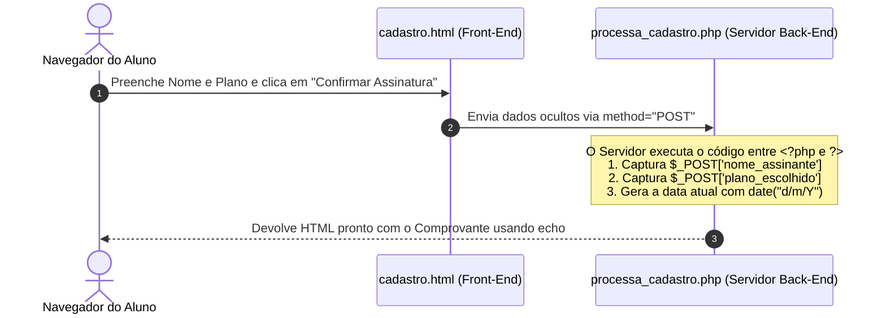

# 📅 Aula 09 (26/10) — Unidade 5: Linguagem de Programação Dinâmica PHP (Início)

* **Duração:** 3h30m – 4h00m (Teoria Rápida + Prática em Laboratório)
* **Projeto Fio Condutor:** Sistema de Vendas de Assinaturas da **EDITORA BR@SIL**

---

## 🎯 Objetivo da Aula
Iniciar o estudo de programação **Back-End (Server-Side)** com a linguagem **PHP**, compreendendo por que arquivos `.php` exigem um Servidor Web para funcionar (do tradicional **XAMPP / `htdocs`** ao nosso container **Docker no GitHub Codespaces**), dominando a sintaxe básica (`<?php ?>`, `echo`, variáveis com `$` e concatenação com `.`) e realizando a primeira comunicação entre um formulário HTML (`method="POST"`) e um script PHP (`$_POST`).

---

## 🔄 Evolução Pedagógica: Aula 08 ➔ Aula 09

| Aspecto | Até a Aula 08 (Front-End: HTML/CSS/JS) | Aula 09 (Início do Back-End: PHP) |
| :--- | :--- | :--- |
| **Onde o código roda?** | No navegador do usuário (*Client-Side*) | No Servidor Web (*Server-Side*: Apache / Container PHP) |
| **Como abrir o arquivo?** | Dois cliques direto no arquivo `.html` | **Obrigatoriamente** via Servidor (`http://localhost/...` ou Porta `8000`) |
| **Identificador do campo HTML** | Atributo `id="..."` (para o `getElementById`) | Atributo **`name="..."`** (para o `$_POST['...']`) |
| **Atributos da tag `<form>`** | `action=""` (processado na própria tela) | **`action="processa_cadastro.php" method="POST"`** |
| **Declaração de variáveis** | `let nome = "Carlos"` ou `const` | **`$nome = "Carlos";`** (sempre com cifrão `$`) |
| **Concatenação de textos** | Sinal de mais (`"Olá " + nome`) | **Ponto** (`"Olá " . $nome`) |

---

## 📚 1. Conteúdo Teórico Estruturado (Guia para Explicação em Aula)

### Tópico 1: Introdução ao PHP e Processamento no Servidor

#### 1.1. O que é PHP (*Hypertext Preprocessor*)?
O **PHP** é uma linguagem de programação dinâmica do lado do servidor (*server-side*).
* Enquanto o **HTML** e o **CSS** montam a casca visual e o **JavaScript** atua no navegador do cliente, o **PHP é executado no computador que hospeda o site (Servidor Web)**.
* Ele processa regras de negócio e interage com bancos de dados antes de entregar apenas o HTML final pronto para o navegador.

#### 1.2. A Regra do `localhost` (Atenção Máxima!)
Páginas `.html` comuns podem ser abertas com dois cliques no arquivo. **Arquivos `.php` NÃO funcionam assim!**
Eles precisam obrigatoriamente ser interpretados por um Servidor Web:

* **No XAMPP Tradicional (Máquina Local Windows):**
  Os arquivos precisam ser salvos dentro da pasta `C:\xampp\htdocs\editora\` com o módulo **Apache** iniciado, sendo acessados via `http://localhost/editora/cadastro.html`.
* **No GitHub Codespaces (Container Docker em Nuvem):**
  O nosso repositório já possui um container Linux com PHP 8.2 configurado. Em vez de usar o `C:\xampp\htdocs\`, iniciamos o servidor direto na pasta `Aula09` na **Porta `8000`**.



---

### Tópico 2: Sintaxe Básica e Variáveis em PHP

#### 2.1. Delimitadores de Código e Exibição de Dados (`echo`)
* Todo trecho de código PHP deve ficar contido entre os delimitadores **`<?php`** e **`?>`**.
* A instrução mais básica de saída é o **`echo`**, responsável por imprimir textos, variáveis ou tags HTML na tela do navegador.
* **Regra obrigatória:** Toda linha de comando em PHP deve terminar com **ponto e vírgula (`;`)**.

```php
<?php
echo "Bem-vindo à Editora Br@sil!";
?>
```

#### 2.2. Criação de Variáveis (`$`) e Concatenação (`.`)
* Em PHP, **toda variável começa obrigatoriamente com o caractere cifrão (`$`)**.
* A linguagem possui tipagem dinâmica, identificando o tipo automaticamente pelo valor atribuído:
  ```php
  $nome = "Carlos";          // Texto (String)
  $plano = 1;                // Número inteiro (Int)
  $dataRegistro = date("d/m/Y"); // Função nativa que retorna a data atual (Dia/Mês/Ano)
  ```
* Para juntar (concatenar) textos e variáveis no PHP, utiliza-se o **operador ponto (`.`)** (e não o `+` como no JavaScript):
  ```php
  echo "Olá, " . $nome . "! Data: " . $dataRegistro;
  ```

---

### Tópico 3: Recebimento de Dados com a Superglobal `$_POST`

#### 3.1. A Ponte entre o HTML e o PHP
Quando o usuário clica no botão `"Confirmar Assinatura"` (`type="submit"`) de um formulário HTML, o navegador despacha os dados para o arquivo indicado no atributo **`action`** usando o método definido em **`method="POST"`**:

```html
<form action="processa_cadastro.php" method="POST">
```

#### 3.2. O Array `$_POST`
O PHP captura automaticamente essas informações através da variável superglobal **`$_POST['nome_do_campo']`**.
> ⚠️ **Ponto de Atenção para a Turma:** O índice entre colchetes no PHP deve coincidir **exatamente** com o atributo **`name="..."`** definido no `<input>` ou `<select>` do HTML!

| No HTML (`cadastro.html`) | No PHP (`processa_cadastro.php`) |
| :--- | :--- |
| `<input type="text" name="nome_assinante">` | `$nome = $_POST['nome_assinante'];` |
| `<select name="plano_escolhido">` | `$plano = $_POST['plano_escolhido'];` |

---

## 💻 2. Prática em Laboratório (Mão na Massa Passo a Passo)

### LABORATÓRIO 06: O PRIMEIRO BACK-END DA EDITORA BR@SIL

**Objetivo:** Configurar a execução do servidor web (entendendo o conceito do `htdocs` do XAMPP aplicado ao GitHub Codespaces), ajustar o formulário HTML da **Editora Br@sil** com método `POST` e criar o primeiro script PHP para receber e processar os dados do assinante no servidor.

---

### PASSO 1: Onde Salvar e Como Rodar os Arquivos (O "Pulo do Gato" do Servidor)

Diferente dos laboratórios de HTML, CSS e JavaScript das aulas anteriores, o PHP precisa ser servido por um Servidor Web. Veja como funciona nos dois ambientes:

#### Opção A — Rodando no GitHub Codespaces (Recomendado em Aula):
Os arquivos já estão na pasta `Aula09/` do repositório. Para transformar a pasta `Aula09` na raiz do nosso servidor web (substituindo o `htdocs`):
1. Abra o **Terminal** do VS Code no Codespaces e digite:
   ```bash
   php -S 0.0.0.0:8000 -t Aula09
   ```
   *(Ou clique com o botão direito sobre o arquivo `Aula09/cadastro.html` e escolha **`PHP Server: Serve project`**).*
2. Clique no botão **"Open in Browser"** (Porta `8000`) que aparecerá no canto inferior direito.
3. *(Opcional)* Clique no link **"🔍 Raio-X: XAMPP vs Codespaces"** ([`diagnostico.php`](diagnostico.php)) no topo da página para ver o servidor Linux e o PHP 8.2 respondendo em tempo real.

#### Opção B — Caso o aluno esteja usando o XAMPP instalado no Windows em casa:
1. Abra o **XAMPP Control Panel** e clique em **Start** no módulo **Apache** (ele deve ficar verde).
2. Abra o Explorador de Arquivos do Windows e navegue até `C:\xampp\htdocs\`.
3. Crie uma pasta chamada `editora` (`C:\xampp\htdocs\editora\`) e salve os arquivos lá dentro.
4. No navegador, acesse: `http://localhost/editora/cadastro.html`.

---

### PASSO 2: O Formulário HTML ([`cadastro.html`](cadastro.html))

No arquivo [`Aula09/cadastro.html`](cadastro.html), definimos o destino do envio dos dados (`action="processa_cadastro.php"`), o método seguro (`method="POST"`) e o atributo `name` em cada campo:

```html
<!DOCTYPE html>
<html lang="pt-br">
<head>
    <meta charset="UTF-8">
    <meta name="viewport" content="width=device-width, initial-scale=1.0">
    <title>Editora Br@sil - Assinatura (Aula 09)</title>
    <link rel="stylesheet" type="text/css" href="estilo.css">
</head>
<body>

    <div id="conteudo">
        <h2>Editora Br@sil - Venda de Assinaturas</h2>
        <p class="subtitulo">
            Preencha os dados abaixo. Ao clicar em confirmar, o formulário enviará os dados via método
            <code>POST</code> para o nosso primeiro script Back-End: <code>processa_cadastro.php</code>.
        </p>

        <!-- action aponta para o PHP que receberá os dados; method define envio seguro via POST -->
        <form action="processa_cadastro.php" method="POST">
            <div class="grupo-campo">
                <label for="nome_assinante">Nome Completo:</label>
                <!-- O atributo 'name' é o identificador que o PHP utilizará no $_POST['nome_assinante']! -->
                <input type="text" id="nome_assinante" name="nome_assinante" class="campo" placeholder="Ex: Carlos Eduardo" required>
            </div>

            <div class="grupo-campo">
                <label for="plano_escolhido">Escolha o Plano:</label>
                <!-- O PHP lerá este valor em $_POST['plano_escolhido'] -->
                <select id="plano_escolhido" name="plano_escolhido" class="campo">
                    <option value="Revista Semestral">Revista Semestral - R$ 59,90</option>
                    <option value="Revista Anual">Revista Anual - R$ 99,90</option>
                    <option value="Plano Digital VIP">Plano Digital VIP - R$ 120,00</option>
                </select>
            </div>

            <p>
                <input type="submit" class="botao" value="Confirmar Assinatura">
            </p>
        </form>
    </div>

</body>
</html>
```

---

### PASSO 3: O Script de Processamento em PHP ([`processa_cadastro.php`](processa_cadastro.php))

No arquivo [`Aula09/processa_cadastro.php`](processa_cadastro.php), criamos a lógica de servidor que lê o que foi digitado no formulário e devolve a página de confirmação processada:

```php
<?php
// 1. Recebendo os dados enviados pelo formulário HTML através de $_POST
$nome = $_POST['nome_assinante'] ?? 'Assinante não informado';
$plano = $_POST['plano_escolhido'] ?? 'Plano não selecionado';

// 2. Criando variáveis de controle e boas-vindas
$dataRegistro = date("d/m/Y"); // Função nativa do PHP para data atual
$horaRegistro = date("H:i:s"); // Hora do processamento no servidor

// 3. Exemplo de concatenação com ponto (.)
$mensagemBoasVindas = "Olá, " . $nome . "! Seu pedido foi recebido pelo servidor da Editora Br@sil.";
?>
<!DOCTYPE html>
<html lang="pt-br">
<head>
    <meta charset="UTF-8">
    <meta name="viewport" content="width=device-width, initial-scale=1.0">
    <title>Confirmação de Assinatura - Editora Br@sil</title>
    <link rel="stylesheet" type="text/css" href="estilo.css">
</head>
<body>

    <div id="conteudo">
        <h2>Assinatura Recebida com Sucesso!</h2>
        <hr>

        <p class="subtitulo"><?php echo $mensagemBoasVindas; ?></p>

        <div class="comprovante-box">
            <p><strong>Prezado(a):</strong> <?php echo $nome; ?></p>
            <p><strong>Plano Contratado:</strong> <?php echo $plano; ?></p>
            <p><strong>Data de Processamento:</strong> <?php echo $dataRegistro . " às " . $horaRegistro; ?></p>
        </div>

        <div class="aviso-sucesso">
            <em>Os dados foram validados pelo servidor PHP e estão prontos para envio ao banco de dados!</em>
        </div>

        <a href="cadastro.html" class="botao botao-voltar">&larr; Voltar ao formulário</a>
    </div>

</body>
</html>
```

---

### PASSO 4: Testar no Navegador (O Teste do Servidor)

1. Com o servidor rodando no Codespaces (Porta `8000`) ou no XAMPP (`http://localhost/editora/cadastro.html`), abra o formulário no navegador.
2. Preencha o seu nome, escolha um plano de assinatura e clique em **"Confirmar Assinatura"**.
3. **Checklist de Validação do Aluno:**
   * [ ] A URL no navegador mudou de `cadastro.html` para `processa_cadastro.php`?
   * [ ] O seu nome e o plano escolhido apareceram formatados na tela gerada pelo PHP?
   * [ ] A data atual gerada pelo `date("d/m/Y")` apareceu corretamente?
   * *Se sim, seu primeiro programa Back-End está funcionando perfeitamente!*

---

## 🧪 3. Atividade Hands-On Individual para os Alunos (`Atividade09-NomeAlunoRA`)

### 🗂️ Estrutura de Arquivos da Aula 09

```text
Aula09/
├── Aula09.md                        # Guia teórico original da Unidade 5
├── README.md                        # Este roteiro completo de aula e laboratório
├── cadastro.html                    # Formulário da Editora Br@sil (Lab 06)
├── processa_cadastro.php            # Script PHP de processamento (Lab 06)
├── diagnostico.php                  # Raio-X visual (XAMPP vs Codespaces)
├── estilo.css                       # Folha de estilos da Editora Br@sil
└── Atividade09-NomeAlunoRA/         # Template para prática Hands-On individual dos alunos
    ├── cadastro.html                # Ficha Completa da Editora Br@sil (5 campos)
    ├── processa_cadastro.php        # Script PHP para o aluno completar os 3 desafios
    └── estilo.css                   # Estilos do comprovante da atividade
```

### Como Realizar a Atividade:

1. Duplique a pasta `Atividade09-NomeAlunoRA` renomeando com seu **Nome e RA** (ex: `Atividade09-JoaoSilva1234567`).
2. Para testar a sua atividade no Codespaces, pare o servidor no terminal (`Ctrl + C`) e inicie apontando para a sua pasta:
   ```bash
   php -S 0.0.0.0:8000 -t Aula09/Atividade09-NomeAlunoRA
   ```
3. Abra os arquivos [`cadastro.html`](Atividade09-NomeAlunoRA/cadastro.html) e [`processa_cadastro.php`](Atividade09-NomeAlunoRA/processa_cadastro.php) da sua pasta e cumpra os **3 Desafios**:
   * 🟢 **Desafio 1 (Aquecimento — Recebimento via `$_POST`):**
     Receber no PHP os **5 campos** enviados pelo formulário HTML da Editora Br@sil (`nome_assinante`, `email_assinante`, `cidade_assinante`, `plano_escolhido` e `forma_pagamento`) armazenando cada um em sua respectiva variável com `$`.
   * 🟡 **Desafio 2 (Aplicação — Concatenação com `.` e `echo`):**
     Montar a variável `$resumoEntrega` juntando o nome do assinante, a cidade de entrega e o e-mail com o operador ponto (`.`) e exibir todas as variáveis no comprovante HTML usando `<?php echo ...; ?>`.
   * 🔴 **Desafio 3 (Desafio Extra — Protocolo Dinâmico):**
     Gerar um código de protocolo único em PHP concatenando a sigla `"BR-"`, o ano atual com `date("Y")` e um número aleatório de 4 dígitos com `rand(1000, 9999)` (ex: `BR-2026-4821`), exibindo-o em destaque no topo do comprovante!
