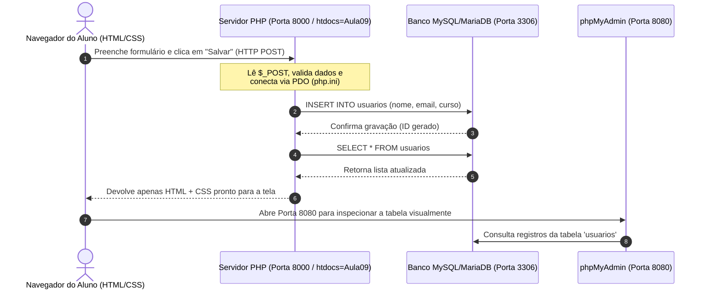

# Aula 09 - Do XAMPP ao GitHub Codespaces: Introdução ao PHP, `htdocs` e phpMyAdmin

* **Tempo Estimado:** 19h15 às 22h00 (~2h45)
* **Pré-requisitos:** HTML5, CSS3 e validação básica de formulários (Aulas 07 e 08).
* **Stack da Aula:** GitHub Codespaces (Docker Debian), PHP 8.2, PDO/MySQL (MariaDB), phpMyAdmin, HTML5 e CSS3.

---

## 1. 🪝 Gancho Inicial (10-15 min)

### A Dor Real do Desenvolvimento
Na **Aula 08**, validamos um formulário de cadastro com JavaScript. Mas o que acontecia quando o usuário atualizava a página (`F5`) ou fechava o navegador? **Todos os dados desapareciam!** Isso acontece porque HTML, CSS e JavaScript rodam apenas no **Cliente (Navegador)** e não têm permissão nem capacidade de salvar dados em um banco centralizado da empresa.

Além disso, se você tentar dar "dois cliques" em um arquivo `.php` no seu computador, o navegador não sabe executá-lo — ele precisa de um **Servidor Web Back-end**.

Historicamente, instalávamos um pacote chamado **XAMPP** em cada computador do laboratório. Hoje, no mercado profissional, usamos **Containers Docker em Nuvem (GitHub Codespaces)**: o mesmo conjunto de ferramentas do XAMPP, porém pronto em segundos no navegador e idêntico para toda a turma.

---

## 2. 📚 Fundamentação Técnica (30-40 min)

### A. O que significa XAMPP e como ele virou um Container Docker?

A sigla **XAMPP** representa a pilha clássica de desenvolvimento web. Veja como cada letra foi convertida para a nossa arquitetura moderna na pasta [`.devcontainer/`](../.devcontainer/):

| Letra | Significado no XAMPP Clássico | Equivalente no Nosso GitHub Codespaces (Docker) |
| :--- | :--- | :--- |
| **X** | **Cross-Platform** (Windows/Linux/Mac) | Container **Linux Debian Bullseye** isolado na nuvem |
| **A** | **Apache** (Servidor Web e pasta `C:\xampp\htdocs`) | Servidor embutido do PHP (`php -S 0.0.0.0:8000 -t Aula09`) |
| **M** | **MariaDB / MySQL** (Banco de Dados na porta `3306`) | **MariaDB Server** rodando nativamente no container (`127.0.0.1:3306`) |
| **P** | **PHP** (Linguagem Back-end + `php.ini`) | **PHP 8.2** com extensões `pdo_mysql` e `mysqli` ativas no [`php.ini`](../.devcontainer/php.ini) |
| **P** | **Perl** *(legado, hoje substituído por ferramentas modernas)* | **phpMyAdmin** (Porta `8080`) + Composer + Xdebug |

---

### B. O Conceito de `htdocs` (Document Root)

No XAMPP tradicional, o servidor Apache só conseguia enxergar arquivos salvos dentro de uma pasta específica do Windows:
* `C:\xampp\htdocs\meu_projeto\index.php` ➔ Acessado via `http://localhost/meu_projeto`

No **GitHub Codespaces**, não ficamos presos ao `C:\xampp\htdocs`. Nós transformamos **qualquer pasta da aula** no nosso `htdocs` usando o parâmetro `-t` (*Target / Document Root*):

```bash
php -S 0.0.0.0:8000 -t Aula09
```

---

### C. Fluxo de Requisição: Cliente vs. Servidor + Banco de Dados



---

### D. Comparativo: Jeito Ingênuo vs. Jeito Profissional no PHP

| Situação | ❌ Jeito Errado / Vulnerável | ✅ Jeito Profissional (Usado na Aula 09) |
| :--- | :--- | :--- |
| **Receber dados do formulário** | Confiar só no JavaScript do navegador | Validar novamente no PHP com `trim()` e `$_POST` |
| **Salvar no Banco SQL** | Concatenar variáveis direto na string SQL (*SQL Injection*) | Usar **PDO Prepared Statements** (`VALUES (?, ?, ?)`) |
| **Exibir dados na tela HTML** | Imprimir direto `<?= $usuario['nome'] ?>` (*XSS*) | Sanitizar saída com `<?= htmlspecialchars($usuario['nome']) ?>` |

---

## 3. 💻 Roteiro de Live Coding (40-50 min)

### Passo 1: Explorando o Container e o phpMyAdmin (Porta 8080)
1. Com o repositório aberto no **GitHub Codespaces**, mostre aos alunos a aba **PORTS** (ao lado do Terminal).
2. Aponte que a **Porta `8080` (`phpMyAdmin`)** e a **Porta `3306` (`MySQL`)** já subiram automaticamente graças ao script [`.devcontainer/start-services.sh`](../.devcontainer/start-services.sh).
3. Clique no ícone de **Globo (Open in Browser)** da porta **`8080`**.
4. Faça login no **phpMyAdmin**:
   * **Utilizador:** `root`
   * **Palavra-passe:** `root`
5. Mostre o banco de dados **`aula_php`** no menu lateral esquerdo e abra o arquivo [`Aula09/banco.sql`](banco.sql) para explicar a estrutura da tabela `usuarios`.

### Passo 2: Subindo o Servidor PHP (2 Formas: Botão Visual ou Terminal)

Graças à extensão **PHP Server (`brapifra.phpserver`)** configurada no nosso [`devcontainer.json`](../.devcontainer/devcontainer.json) (inspirada no repositório acadêmico `FMI-VT/plain-php-codespace`), os alunos podem rodar o PHP de duas maneiras:

#### Opção A — Com 1 Clique no VS Code (Igual ao "Live Server" do HTML):
1. Abra o arquivo [`Aula09/index.php`](index.php) no editor do VS Code.
2. Clique com o **botão direito** no código (ou no **ícone azul do PHP** no canto superior direito do editor) e selecione **`PHP Server: Serve project`**.
3. Clique no aviso **"Open in Browser"** da **Porta `8000`** e navegue até `/Aula09/index.php`.

#### Opção B — Via Terminal (Definindo a pasta `Aula09` como `htdocs`):
1. No Terminal do Codespaces, execute:
   ```bash
   php -S 0.0.0.0:8000 -t Aula09
   ```
2. Clique no botão **"Open in Browser"** que aparecerá (ou na aba **PORTS ➔ Porta 8000**).
3. Na barra superior da página que abrir, clique em **"🔍 Ver Raio-X do Container"** (`diagnostico.php`) para mostrar o PHP 8.2 lendo as informações reais do Linux, o `DOCUMENT_ROOT` (nosso `htdocs`), a extensão `pdo_mysql` carregada pelo `php.ini` e a conexão ativa com o MariaDB.

### Passo 3: Testando o Cadastro (`index.php` + `conexao.php`)
1. Volte para [`index.php`](index.php), cadastre 2 alunos pelo formulário HTML e mostre que:
   * Ao dar `F5` ou abrir em outra aba, **os dados permanecem salvos**!
   * Vá até a aba do **phpMyAdmin (Porta 8080)**, clique na tabela `usuarios` e mostre os registros recém-inseridos lá dentro.

> ⚠️ **Onde os alunos costumam errar (Pontos de Atenção):**
> 1. Esquecer o atributo **`name="..."`** no `<input>` do HTML (o JavaScript usa `id`, mas o PHP no servidor enxerga apenas o atributo `name` dentro do `$_POST`!).
> 2. Tentar rodar o servidor sem o `-t Aula09` ou apontando para a pasta errada.

---

## 4. 🧪 Laboratório Prático Hands-On (45-60 min)

### Cenário de Negócio: Central de Chamados (Help Desk)
Os alunos deverão utilizar a pasta [`Atividade09-NomeAlunoRA`](Atividade09-NomeAlunoRA/) (duplicando-a ou renomeando com seu Nome e RA, ex: `Atividade09-JoaoSilva1234567`).

Para testar a atividade no Codespaces, o aluno deve parar o servidor anterior (`Ctrl + C` no terminal) e apontar o `-t` para a pasta da sua atividade:
```bash
php -S 0.0.0.0:8000 -t Aula09/Atividade09-NomeAlunoRA
```

### Níveis de Progressão da Atividade:

* 🟢 **Nível 1 — Aquecimento (PHP + Formulário HTML):**
  * No arquivo `index.php` da atividade, inspecionar como os 4 campos do formulário HTML (`txtSolicitante`, `selSetor`, `selPrioridade`, `txtDescricao`) possuem o atributo `name` e são capturados pelo array superglobal `$_POST` no topo do script PHP.
  * Preencher seu Nome e RA no cabeçalho do arquivo e realizar o primeiro teste de envio.

* 🟡 **Nível 2 — Aplicação (Validação Back-end + Gravação PDO):**
  * Testar as regras de negócio no servidor:
    1. Tentar enviar o formulário em branco (deve exibir a caixa vermelha `.status-box.erro`).
    2. Tentar enviar uma descrição curta com menos de 10 letras (deve bloquear exigindo mínimo de 10 caracteres).
    3. Enviar um chamado válido para o setor de **TI / Desenvolvimento** com prioridade **Alta** e verificar a gravação no banco.

* 🔴 **Nível 3 — Desafio (Integração Reversa com o phpMyAdmin):**
  * Abrir o **phpMyAdmin na Porta 8080** (usuário `root`, senha `root`).
  * Acessar o banco **`aula_php`** ➔ tabela **`chamados_suporte`**.
  * Usar a aba **Inserir (Insert)** do próprio phpMyAdmin para cadastrar manualmente um chamado com prioridade **Média** ou **Alta**.
  * Voltar para a página do sistema PHP (Porta 8000), clicar em **Recarregar** e comprovar que o sistema PHP lista automaticamente o registro criado direto no banco, aplicando o badge colorido correspondente (`badge-ok`, `badge-alerta` ou `badge-erro`)!

---

## 5. ✅ Fechamento e Checklist de Revisão (10 min)

Faça estas 3 perguntas rápidas para a turma antes de encerrar a aula:

1. **Por que o PHP usa o atributo `name` do `<input>` em vez do `id` quando enviamos um formulário?**
   * *Resposta esperada:* Porque no protocolo HTTP, o navegador monta o pacote de envio (`POST` ou `GET`) usando os pares `name=valor`. O `id` existe apenas para o CSS e o JavaScript no navegador.
2. **Qual era o papel da pasta `C:\xampp\htdocs` no XAMPP e como a substituímos hoje no terminal do Codespaces?**
   * *Resposta esperada:* O `htdocs` era a pasta raiz pública (*Document Root*) do servidor web. No Codespaces, usamos `php -S 0.0.0.0:8000 -t NomeDaPasta` para transformar qualquer pasta do projeto na raiz do servidor.
3. **Por que continuamos validando os campos no PHP (`if ($nome === '')`) se já aprendemos a validar com JavaScript na Aula 08?**
   * *Resposta esperada:* Porque a validação no JavaScript (Front-end) serve para melhorar a experiência do usuário (UX rápida), mas pode ser facilmente burlada ou desativada no navegador. A validação no PHP (Back-end) é a barreira real de segurança antes de gravar no banco de dados.

