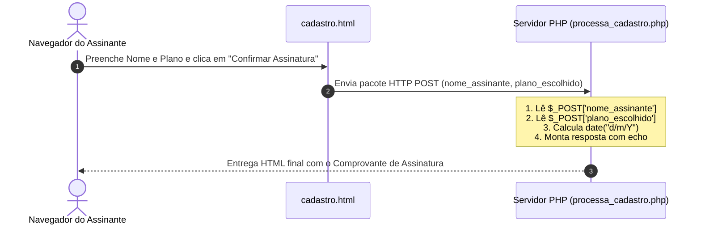

# Aula 09 - Unidade 5: Linguagem de Programação Dinâmica PHP (Início)

* **Data / Duração:** 26/10 | 19h15 às 22h00 (Teoria Rápida + Prática em Laboratório)
* **Projeto Fio Condutor:** Sistema de Vendas de Assinaturas da **EDITORA BR@SIL**
* **Pré-requisitos:** Estrutura de formulários HTML5 e estilização CSS3 (Aulas 06 a 08).

---

## 1. 🪝 Gancho Inicial (10-15 min)

Até a **Aula 08**, nosso sistema de vendas de assinaturas da **Editora Br@sil** validava os campos no navegador com JavaScript, mas não tinha um **Servidor Back-End** para receber o pedido de verdade.

Além disso, faça um teste rápido com a turma:
> *"Se abrirmos um arquivo `.html` com dois cliques no computador, o navegador desenha a página na hora. Mas o que acontece se dermos dois cliques em um arquivo `.php`?"*

O navegador apenas mostra o código-fonte como texto puro ou tenta baixar o arquivo! Isso acontece porque o navegador **não entende PHP**. O código PHP precisa ser processado antes por um **Servidor Web** (como o Apache do XAMPP ou o nosso Container Linux no **GitHub Codespaces**).

---

## 2. 📚 Fundamentação Técnica (30-40 min)

### Tópico 1: Introdução ao PHP e a Regra do `localhost`

* **O que é PHP (*Hypertext Preprocessor*)?**
  É uma linguagem de programação dinâmica do lado do servidor (*server-side*). Enquanto o HTML e o CSS montam a casca visual e o JavaScript atua no navegador do usuário, o **PHP roda no servidor**, processando regras de negócio e preparando os dados antes de devolver apenas o HTML pronto para o cliente.
* **A Regra do `localhost` (Do XAMPP ao GitHub Codespaces):**
  Arquivos `.php` precisam obrigatoriamente ser servidos por um servidor web via protocolo `http://`:

| Ambiente | Onde os arquivos ficam salvos? | Como acessar no navegador? |
| :--- | :--- | :--- |
| **XAMPP Tradicional (Local)** | `C:\xampp\htdocs\editora\` | `http://localhost/editora/cadastro.html` |
| **GitHub Codespaces (Docker)** | Pasta `Aula09/` do próprio repositório | Porta `8000` (`php -S 0.0.0.0:8000 -t Aula09`) |



---

### Tópico 2: Sintaxe Básica, Variáveis (`$`) e Concatenação (`.`)

1. **Delimitadores e Ponto e Vírgula:**
   * Todo código PHP fica dentro de `<?php` e `?>`.
   * Toda instrução termina obrigatoriamente com ponto e vírgula (`;`).
   * O comando **`echo`** imprime textos, variáveis ou tags HTML na tela.
2. **Variáveis (`$`) e Concatenação (`.`):**
   * Toda variável começa com cifrão (`$`):
     ```php
     $nome = "Carlos";
     $plano = "Revista Anual";
     ```
   * **Atenção (Diferença do JavaScript para o PHP):** No JavaScript juntávamos textos com `+`. No **PHP**, o `+` serve apenas para soma matemática; para juntar textos e variáveis usamos o **ponto (`.`)**:
     ```php
     echo "Olá, " . $nome . "! Seu plano é: " . $plano;
     ```

---

### Tópico 3: Recebimento de Dados com a Superglobal `$_POST`

Quando o usuário clica no botão `submit` de um formulário `<form action="processa_cadastro.php" method="POST">`, o PHP captura os dados enviados através do array superglobal **`$_POST`**:

| No Formulário HTML (`cadastro.html`) | No Script PHP (`processa_cadastro.php`) |
| :--- | :--- |
| `<input type="text" name="nome_assinante">` | `$nome = $_POST['nome_assinante'];` |
| `<select name="plano_escolhido">` | `$plano = $_POST['plano_escolhido'];` |

> ⚠️ **Regra de Ouro para a Turma:** O nome dentro dos colchetes `$_POST['...']` deve ser **exatamente igual** ao atributo **`name="..."`** do HTML (respeitando letras maiúsculas e minúsculas!).

---

## 3. 💻 Roteiro de Live Coding — Laboratório 06: O Primeiro Back-End da Editora Br@sil (40-50 min)

### Passo 1: Iniciar o Servidor no GitHub Codespaces (Nosso `htdocs`)
No terminal do GitHub Codespaces, execute:
```bash
php -S 0.0.0.0:8000 -t Aula09
```
*(Ou clique com o botão direito em `Aula09/cadastro.html` e selecione **`PHP Server: Serve project`**).*

### Passo 2: Demonstrar o Raio-X do Servidor ([`diagnostico.php`](diagnostico.php))
Abra `diagnostico.php` pelo navegador para mostrar aos alunos as primeiras variáveis em PHP (`$nomeSistema`, `$versaoPhp`, `$dataAtual`) sendo impressas com `<?php echo ...; ?>` e explicar como a pasta `Aula09` substitui o antigo `C:\xampp\htdocs\editora\`.

### Passo 3: O Formulário HTML ([`cadastro.html`](cadastro.html)) e o Processamento ([`processa_cadastro.php`](processa_cadastro.php))
1. Abra [`Aula09/cadastro.html`](cadastro.html) e destaque:
   * `<form action="processa_cadastro.php" method="POST">`
   * `name="nome_assinante"` e `name="plano_escolhido"`.
2. Abra [`Aula09/processa_cadastro.php`](processa_cadastro.php) e mostre a captura com `$_POST['nome_assinante']`, a função `date("d/m/Y")` e a exibição com `<?php echo $nome; ?>`.
3. Preencha o formulário no navegador, clique em **"Confirmar Assinatura"** e comemore com a turma o primeiro fluxo Front-End ➔ Back-End funcionando!

---

## 4. 🧪 Atividade Prática Hands-On para os Alunos (45-60 min)

### Estrutura de Arquivos da Aula 09

```text
Aula09/
├── Aula09.md                        # Guia base do calendário acadêmico (Unidade 5)
├── README.md                        # Roteiro didático e instruções do Codespaces
├── cadastro.html                    # Formulário da Editora Br@sil (Laboratório 06)
├── processa_cadastro.php            # Primeiro script PHP de processamento (Laboratório 06)
├── diagnostico.php                  # Painel didático comparando XAMPP vs Codespaces
├── estilo.css                       # Folha de estilos da Editora Br@sil
└── Atividade09-NomeAlunoRA/         # Prática Hands-On individual dos alunos
    ├── cadastro.html                # Ficha completa de assinatura (5 campos)
    ├── processa_cadastro.php        # Script PHP com os 3 Desafios progressivos
    └── estilo.css                   # Estilos do comprovante de assinatura
```

### Instruções para os Alunos:
1. Dupliquem ou renomeiem a pasta `Atividade09-NomeAlunoRA` com seu **Nome e RA** (ex: `Atividade09-JoaoSilva1234567`).
2. Para testar a atividade no navegador do Codespaces, parem o servidor anterior (`Ctrl + C`) e iniciem apontando para a pasta da atividade:
   ```bash
   php -S 0.0.0.0:8000 -t Aula09/Atividade09-NomeAlunoRA
   ```
3. Cumpram os **3 Desafios** dentro de [`Atividade09-NomeAlunoRA/processa_cadastro.php`](Atividade09-NomeAlunoRA/processa_cadastro.php):
   * 🟢 **Desafio 1 (Aquecimento — `$_POST` e Variáveis `$`):** Capturar os 5 campos enviados pelo `cadastro.html` (`nome_assinante`, `email_assinante`, `cidade_assinante`, `plano_escolhido`, `forma_pagamento`) em variáveis do PHP.
   * 🟡 **Desafio 2 (Aplicação — Concatenação `.` e `echo`):** Montar a variável `$resumoEntrega` concatenando o nome, a cidade e o e-mail com o operador ponto (`.`) e exibir todos os dados no cartão HTML.
   * 🔴 **Desafio 3 (Desafio Extra — Protocolo Dinâmico):** Gerar um número de protocolo de atendimento combinando `"BR-"` + ano atual (`date("Y")`) + número sorteado (`rand(1000, 9999)`) e exibi-lo no topo do comprovante!

---

## 5. ✅ Fechamento e Checklist de Revisão (10 min)

1. **Por que não podemos abrir o arquivo `processa_cadastro.php` dando dois cliques nele no computador?**
   * *Resposta:* Porque o navegador só interpreta HTML, CSS e JS. O código PHP precisa passar por um Servidor Web (Apache no XAMPP ou servidor do PHP no Codespaces) para ser traduzido em HTML.
2. **Qual símbolo usamos no PHP para declarar variáveis e qual símbolo usamos para concatenar (juntar) textos?**
   * *Resposta:* Cifrão (`$`) para variáveis e ponto (`.`) para concatenação.
3. **Como o arquivo `processa_cadastro.php` sabe exatamente qual campo do HTML ele está lendo dentro do `$_POST`?**
   * *Resposta:* Pelo atributo `name="..."` configurado nas tags `<input>` e `<select>` do formulário HTML.
